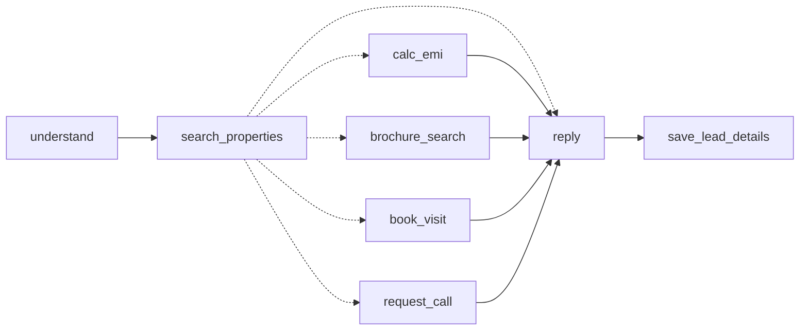

# LeadOps

LeadOps finds the genuine buyers among a real estate website's visitors. One script tag tracks every visitor,
every visitor is scored live (Bot, Junk, Review, Cold, Warm or Hot, with the reasons), and the sales team watches
them arrive on a live dashboard, with the buyer details the assistant picked up.

Built so far, from [LEADOPS_PLAN.md](LEADOPS_PLAN.md): a demo property site, the tracking SDK, the event API, a
basic property assistant, a live sales dashboard, a traffic simulator (Week 1) and the scoring engine (Week 2).

## What's where

| Folder | What it holds | Owner |
|---|---|---|
| `frontend/` | React demo site (`/`, `/property/:id`) and the sales dashboard (`/dashboard`) | A |
| `sdk/` | `leadops.js`, the tracking script, and `demo.html`, a plain page that uses it | A |
| `backend/app/` | FastAPI: events, listings, enquiries, chat, feedback, dashboard WebSocket | B |
| `backend/app/ai/` | LLM wrapper, the LangGraph assistant, buyer-detail extraction, listing and brochure search | C |
| `backend/app/scoring/` | the scoring engine: features, rules, the LightGBM model, labels and reasons | B |
| `backend/data/` | `listings.json` (18 fictional homes in 5 cities), a fictional brochure for each, throwaway email domains, the trained model | everyone |
| `ml/` | `simulator.py` (labelled bot / junk / genuine traffic) and `train.py` (trains the model) | B |
| `docs/CONTRACTS.md` | the shared JSON contracts; read it before changing an API | everyone |

## Run it

You need Python 3.11 or newer and Node 20 or newer (tested with Python 3.14 and Node 24).

**Backend** (first terminal), on Windows PowerShell:

```powershell
cd backend
python -m venv .venv
.venv\Scripts\python -m pip install -r requirements.txt
copy .env.example .env          # optional: paste an LLM key into .env
.venv\Scripts\python -m uvicorn app.main:app --reload
```

On Mac or Linux:

```bash
cd backend
python3 -m venv .venv
.venv/bin/python -m pip install -r requirements.txt
cp .env.example .env
.venv/bin/python -m uvicorn app.main:app --reload
```

The API runs at http://localhost:8000, with interactive docs at http://localhost:8000/docs.

**Frontend** (second terminal):

```bash
cd frontend
npm install
npm run dev
```

Open http://localhost:5173 for the demo site and http://localhost:5173/dashboard for the sales dashboard.

## Try it

1. Open the dashboard in one window and the demo site in another, then browse. You appear on the dashboard within
   seconds with a label and an intent score that climb as you use the EMI calculator, the floor plan and the
   assistant. Click your row for "Why this label" (the reasons, the human check's SHAP factors and the intent
   points), then your pages, scrolls and clicks in order. The buttons above the table filter by label.
2. Open http://localhost:8000/sdk/demo.html, a plain HTML page with the same script tag. That visit appears too.
   To show it working on a different website, serve it from another address:
   `python -m http.server 5500 --directory sdk`, then open http://localhost:5500/demo.html.
3. Ask the assistant "3BHK under 90L in Pune?", "Pune mein 90 lakh tak 3BHK chahiye" or "पुण्यात 90 लाखांपर्यंत 3BHK हवा
   आहे". It answers from the listings and saves the budget, BHK and city on the visitor. Then try "What's the payment
   plan at Aranya Courtyard?", "EMI with 30% down?" and "Book a site visit on Saturday morning".
4. Keep browsing a home for a minute or two after using the EMI calculator: when you look serious but haven't left any
   details, the assistant offers to send the floor plan on WhatsApp. Accept it and you arrive on the dashboard as a
   lead "found by the assistant". A salesperson can also press **Send an offer now** on an anonymous Warm or Hot visitor.
5. Send an enquiry from a property page. The dashboard shows its label and its checks: phone, email, name, message,
   the hidden honeypot field and how fast the form was filled in.
6. Click that visitor on the dashboard. The panel opens with a three-line brief and the next step. **Draft a follow-up**
   writes a WhatsApp or email message in the buyer's language, ready to edit and open in WhatsApp. **Book a site visit**
   takes one click, and **Genuine**, **Fake** and **Converted** relabel the visitor at once.
7. On the dashboard, press **Simulate traffic**: 200 bots, 30 junk leads and 20 real buyers arrive over about 30
   seconds and are sorted live, ending with a scoreboard. **Run a real bot** opens a browser window and lets a
   Playwright bot attack the site. **Clear simulated visitors** gets the dashboard ready for the next rehearsal.

## Simulator

`python ml/simulator.py` writes 500 labelled visitors (200 bot, 100 junk, 200 genuine) to `ml/data/sessions.jsonl`
for training. Each line is a *visitor record*, the same shape live scoring reads from the database
(`backend/app/scoring/features.py`). Besides plain scrapers and form bots, it makes the hard cases: stealth bots
that hide `webdriver` and fake mouse moves, slow scrapers, buyers who come back on later days, NRI buyers with
foreign numbers, browser autofill, privacy browsers and ad blockers. The same `--seed` gives the same data.
`--send URL` also posts the visitors to a running backend. `--chat` sends their chat messages too, which calls your
LLM if a key is set. The dashboard's **Simulate traffic** button uses the same simulator and never calls an LLM.

## Playwright bots

Real bots for testing and for the live attack demo (`ml/bots/run_bots.py`). Start the backend and the site
first, then:

```bash
backend\.venv\Scripts\python ml/bots/run_bots.py --api http://localhost:8000   # each bot once, prints its label
backend\.venv\Scripts\python ml/bots/run_bots.py --kind stealth --headed      # watch one work (for the demo)
```

| Bot | What it does | What catches it |
|---|---|---|
| `naive` | fills in every field, the hidden honeypot too, and submits in a second | the rules: honeypot, `navigator.webdriver` |
| `stealth` | hides `webdriver`, uses a normal user agent, moves the mouse, scrolls, types with pauses, skips the honeypot | only its behaviour: the ML model ("the mouse jumped about 99 pixels at a time") |
| `scraper` | opens all 18 listings in about 10 seconds and copies the prices | the rules: `navigator.webdriver`, a headless user agent |

They open the site through a `lo_test=bot` tester link, so their visits join the real test set that `ml/train.py`
reports on. They drive the Edge or Chrome you already have; without either (Mac/Linux), run
`backend/.venv/bin/python -m playwright install chromium` once. `--count 5` repeats each bot, `--slow-mo 300`
slows a headed bot down for an audience.

## Scoring

Every event batch, enquiry and chat message rescores its visitor, in a few milliseconds:

- **Rules** (`backend/app/scoring/rules.py`) check the details: the hidden honeypot, `navigator.webdriver`, the
  phone number (Indian mobiles; NRI numbers are fine), placeholder names and emails, spam and broker messages.
  *Certain* signals decide on their own; *strong* ones have innocent explanations (browser autofill, an ad
  blocker), so one alone only sends a visitor to Review.
- **The ML human check** (`model.py`): a LightGBM model that looks only at *how* someone browses (timing, mouse
  and touch activity, the browser) and gives the chance that it's a real person. SHAP values say why.
- **Intent points** (`combine.py`), out of 100: time on property pages, repeat visits, details shared with the
  assistant, EMI calculator, floor plan, a valid enquiry, a focused search and the filters. Cold < 40, Warm 40-70,
  Hot > 70.

- **Says versus does** (`consistency.py`): the stated budget, city, BHK and purpose against the homes the visitor
  actually opened. A mismatch is a question for the sales call and never changes the label.
- **Sales verdicts**: Genuine, Fake and Converted on the dashboard overrule all of the above at once.

`GET /visitors/{id}` returns the whole breakdown as `score_detail` (docs/CONTRACTS.md, section 6).

**Training the model.** The trained model is committed (`backend/data/model/`), so you only retrain after
changing the features or the simulator. Install the training packages once, then train and relabel everyone:

```bash
backend\.venv\Scripts\python -m pip install -r ml/requirements.txt      # Mac/Linux: backend/.venv/bin/python
python ml/simulator.py --bots 800 --junk 400 --genuine 800
backend\.venv\Scripts\python ml/train.py
```

Then restart the backend, or press **Relabel everyone** on the dashboard to load the new model without a restart.

`ml/train.py` prints how the model and the whole engine do on simulated visitors it never saw, and on the real
test set (tester-link visitors in your database). Simulated numbers run high; the real test set is what counts.

**Learning from the sales team.** Training also reads the verdicts in your database. Genuine and Converted visitors
join the training data with extra weight. A Fake visitor counts as a bot only when nothing else explains it, because a
broker or a made-up number is a real person with bad details. With 20 or more verdicts, `ml/train.py` also prints
suggested intent points for the team to review; it never changes them by itself.

`python ml/simulator.py --send http://localhost:8000 --report` sends fresh traffic to a running backend and prints
how each kind of visitor was labelled.

## Collecting real test sessions

To measure LeadOps on real people, classmates browse the demo site through a **tester link**. The link marks
their browser as a test session. Scoring ignores the mark; `ml/train.py` uses it to build the real test set.

| Link | Use it for |
|---|---|
| `/?lo_test=genuine&lo_tester=t01` | browsing as a real buyer |
| `/?lo_test=junk&lo_tester=t02` | playing a junk lead on purpose: a broker asking for inventory, a fake number |
| `/?lo_test=bot&lo_tester=bot-naive` | bots (the Playwright bots add this themselves) |
| `/?lo_test=off` | clearing the mark from a browser |

Give each tester a code (`t01`, `t02`, ...) rather than their name. The browser remembers the mark, so a repeat
visit from the same device counts too. The dashboard shows a "Test" chip on these visitors.

**What to tell testers**

> Open the link on your phone or laptop and look for a home as if you were really buying: pick a city and a
> budget, open a few homes, try the EMI calculator or the floor plan if you'd use them, and ask the assistant
> anything. Take 5 to 10 minutes. If you send an enquiry, use a made-up 10-digit number starting with 6 to 9 (not
> 9999999999) and a made-up email, never your real ones.

**Running it over the same Wi-Fi**

1. Connect the laptop and the testers' devices to the same Wi-Fi. If the college Wi-Fi stops devices from
   reaching each other, use a phone hotspot instead.
2. Find the laptop's address: `ipconfig` on Windows (the IPv4 address, for example `192.168.1.23`),
   `ipconfig getifaddr en0` on a Mac, `hostname -I` on Linux.
3. Start the backend so other devices can reach it, from `backend/`:
   `.venv\Scripts\python -m uvicorn app.main:app --host 0.0.0.0` (Mac/Linux: `.venv/bin/python -m uvicorn ...`).
4. Start the site the same way, from `frontend/`: `npm run dev -- --host`.
5. When Windows asks, allow Python and Node on private networks. If devices still can't connect, set the Wi-Fi
   network to Private (Settings > Network & internet).
6. Share `http://192.168.1.23:5173/?lo_test=genuine&lo_tester=t01`, with your laptop's address. The site finds the
   API on the same laptop by itself.

## The smart engagement trigger

Most serious buyers leave without filling in a form. After each event batch, `backend/app/scoring/nudge.py` looks for a
visitor who clearly looks human (`human_prob` 0.8 or more), has intent 40 or more, has left no contact details, isn't
chatting, has spent at least a minute on this visit and is on a property page. They get one offer per visit, two a day
at most, in their language: the floor plan on WhatsApp, a personal EMI plan, a site visit or a shortlist of homes.

Any website using the SDK can show these offers:

```js
LeadOps.onNudge(function (offer) {
  // offer.text, offer.cta, offer.kind, offer.listing_id
  LeadOps.track("nudge_shown", { nudge_id: offer.id, kind: offer.kind });
});
```

## Tests

```bash
cd backend
.venv\Scripts\python -m pytest        # Mac/Linux: .venv/bin/python -m pytest
```

The tests use a temporary database and never call a real LLM. The Claude request shape is checked offline.

## The LLM (optional)

The assistant works without a key, answering from templates. To use an LLM, put one key in `backend/.env`:
`ANTHROPIC_API_KEY` (Claude; the default model is `claude-opus-5-5`, and `LLM_MODEL=claude-haiku-5-5` costs much
less), `GEMINI_API_KEY` or `GROQ_API_KEY`. `GET /health` shows which one is in use. If a call fails, the assistant
falls back to templates, so a demo never breaks. Phone numbers and emails are masked before text reaches an LLM,
and names are never sent.

The assistant is a [LangGraph](https://langchain-ai.github.io/langgraph/) graph (`backend/app/ai/agent.py`). LangGraph only
runs the steps; every LLM call still goes through `llm_client.py`.



It answers in English, Hindi, Hinglish and Marathi, and its templates cover all four when there is no key. Brochure
questions are answered from `backend/data/brochures/` with BM25 keyword search. When contact details are needed the
chat shows a small form, so phone numbers never pass through the LLM.

With a key, the LLM does three jobs, each falling back to rules if a call fails:

- **Understanding** (`understand` in `agent.py`, `extract.py`): reads the message with the last few turns ("same budget,
  but in Bengaluru", "80-85 lakh ke beech") and works out what the visitor wants. Every value is checked (a known
  city, a sensible budget, BHK 1 to 6) before it's used. Claude returns it as a structured output.
- **Replies** in the visitor's language, written only from what the tools found.
- **Visitor type** (`backend/app/ai/classify.py`): end buyer, investor, tenant, broker or spam, from the enquiry
  message and chat, worked out after the response is sent so nobody waits. It runs again only when the messages
  change. Without a key, keyword rules do this ("on rent", "channel partner", "rental yield"); a confident broker,
  spam or tenant is labelled Junk.

## Team

| Member | Owns |
|---|---|
| A, Frontend | demo site, SDK, chat widget, smart-trigger UI, dashboard, live feed, analytics charts |
| B, Backend + ML | FastAPI, database, event ingestion, rules, features, simulator, Playwright bots, ML + SHAP, WebSocket, feedback loop |
| C, GenAI | LLM wrapper, RAG, LangGraph agent, multilingual replies, JSON extraction, visitor-type classification, consistency check, explanations, follow-ups |

## Notes

- Settings live in `backend/.env`, which is never committed. New settings go into `backend/.env.example` first.
- `backend/leadops.db` is the local SQLite database. Delete it (with the backend stopped) to start fresh.
- This folder is inside OneDrive. `node_modules` and `.venv` hold thousands of files, so pause OneDrive syncing
  while installing if it gets slow.
