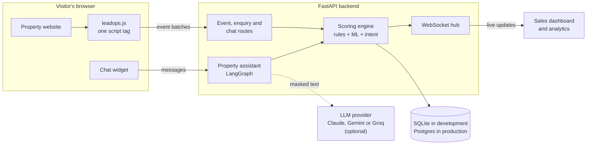
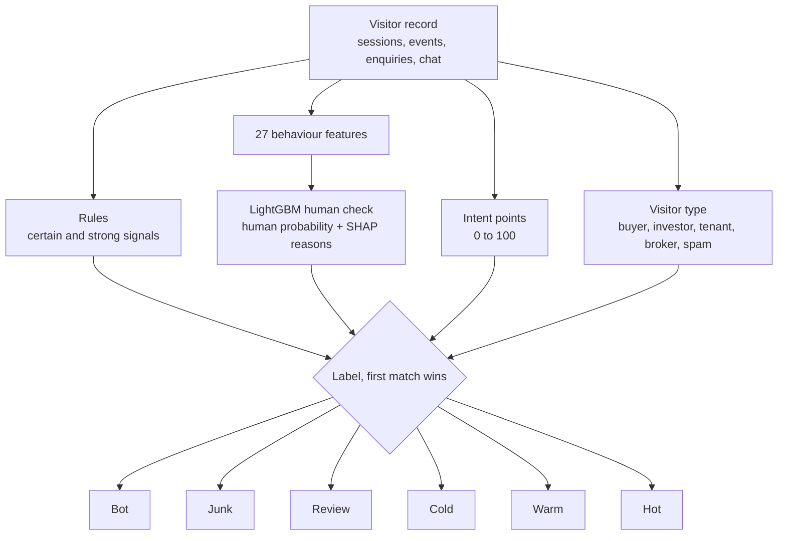
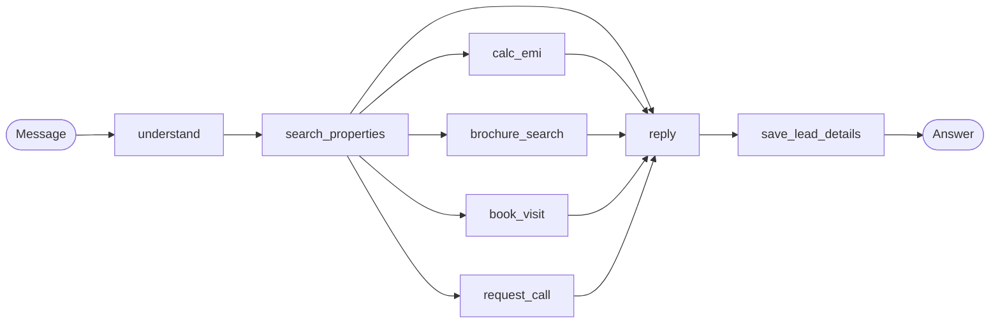
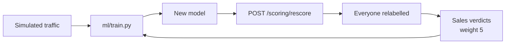

# LeadOps architecture

How LeadOps turns a stranger on a property website into a decision the sales team can act on. The exact JSON shapes are in
[CONTRACTS.md](CONTRACTS.md).

## The big picture

| Part | Where | Job |
|---|---|---|
| Tracking script | `sdk/leadops.js` | Collects behaviour after consent and sends it in batches |
| Demo site, dashboard, analytics | `frontend/` | What buyers and the sales team see |
| API | `backend/app/api/` | One module for each group of routes |
| Scoring engine | `backend/app/scoring/` | Decides each visitor's label and explains it |
| Assistant and other AI | `backend/app/ai/` | Chat, buyer details, visitor type, lead briefs, follow-ups |
| Training and measurement | `ml/` | Simulator, real Playwright bots, training, `evaluate.py` |

## What happens to one visitor

1. **Consent.** The site loads the script with `data-consent="required"`. Nothing is sent or stored until the visitor accepts.
2. **Tracking.** The script records page views, scrolling, clicks, mouse activity counts, the EMI calculator, floor plan
   downloads and similar events. It counts key presses but never records which keys.
3. **Ingestion.** Batches arrive at `POST /events`. Odd input is cleaned rather than rejected, so one bad value never loses a batch.
4. **Scoring.** Every batch, enquiry and chat message rescores the visitor.
5. **An offer, if it helps.** A visitor who looks human and interested can get an offer in the `/events` response.
6. **The dashboard.** The new score goes to every open dashboard over the WebSocket, with the reasons in plain words.
7. **Sales acts and teaches.** A salesperson's verdict overrules the engine, and the next training run learns from it.

## The scoring engine

Three independent checks feed one decision in `scoring/combine.py`.

**Rules** (`rules.py`). A *certain* signal decides alone: a filled honeypot, `navigator.webdriver`, an automation user agent, a
fake phone number or a spam message. A *strong* signal has an innocent explanation, such as browser autofill, so one alone sends a
visitor to Review at most.

**The ML human check** (`model.py`). LightGBM on 27 behaviour features, trained on simulated visitors that are both whole and cut
short, because live scoring sees a visit while it is still happening. Below 0.2 human probability a visitor can be labelled Bot;
below 0.5 they can go to Review. SHAP values name the features behind each score.

**Intent points** (`combine.py`). Points for buying signals, capped at 100: time on property pages (up to 20), repeat visits (up
to 15), details shared with the assistant (up to 15), a requested site visit (15), the EMI calculator (12), the floor plan (12),
a valid enquiry (10), a focused search (up to 10), filters (6) and a verified phone (5).

| Label | When | What sales does |
|---|---|---|
| **Bot** | Certain bot signal, two strong ones, or a very low human probability | Nothing: filtered out |
| **Junk** | Fake details, spam, a rival broker or a renter | Nothing: filtered out |
| **Review** | Mixed signals, including a likely junk visitor with intent of 70 or more | A person looks |
| **Cold** | Intent under 40 | Leave to nurture |
| **Warm** | Intent 40 to 70 | Follow up |
| **Hot** | Intent over 70 | Call first |

Two safeguards protect real buyers. High intent turns a junk verdict into Review, so a buyer is never silently thrown away. And a
salesperson's verdict always wins: Fake makes a visitor Junk, while Genuine or Converted leaves only intent to decide.

## The property assistant

Each chat message is one run of a LangGraph graph (`ai/agent.py`).

- **Grounded answers.** Replies are written from search results only: the 18 fictional listings and their brochures. Brochure
  search uses BM25 keyword ranking, which is small enough for the free hosting plan.
- **Languages.** English, Hinglish, Hindi and Marathi.
- **One LLM wrapper.** Every call goes through `ai/llm_client.py`, so changing the key changes the provider.
- **It never breaks.** With no key, or when a call fails, templates and patterns answer instead.

## The smart engagement trigger

Some real buyers browse carefully and leave without enquiring. After each event batch, `scoring/nudge.py` can offer such a visitor
something useful, like a floor plan on WhatsApp. An offer needs a human probability of at least 0.8, intent of at least 40 and at
least 60 seconds on the site. It waits if the visitor is talking to the assistant, and a visitor gets at most two a day. Offers
come from templates in the visitor's language, and every outcome is saved so the analytics page can report on it.

## Data

Nine tables, defined in `backend/app/models.py`:

| Table | Holds |
|---|---|
| `visitors` | One row per browser: label, score, buyer details, visitor type |
| `sessions` | Visits, with IP address and timing |
| `events` | Everything the script reported |
| `leads` | Enquiries and their phone check |
| `chat_messages` | Conversations with the assistant |
| `site_visits` | Requested and confirmed site visits |
| `nudges` | Offers and what became of them |
| `scores` | The history of label changes |
| `feedback` | Sales verdicts |

## Privacy (DPDP Act 2023)

- **Consent first.** Tracking waits for the visitor's answer, and refusing clears their IDs.
- **Masking.** `ai/privacy.py` masks phone numbers and emails before any text reaches an LLM.
- **Names stay out.** Follow-ups are written with a `{name}` placeholder, and the first name is added afterwards.
- **Retention.** After 180 days by default, a daily job deletes browsing data and removes personal details from old enquiries.
- **Erasure.** `DELETE /visitors/{id}` removes a visitor and everything linked to them.
- **A locked dashboard.** `DASHBOARD_PASSCODE` protects every route that shows personal data.

## The learning loop

`ml/evaluate.py` measures the result on real people, real bots and simulated traffic separately, and writes
[RESULTS.md](RESULTS.md).

## Deployment

The site runs on Vercel, the API on Render and the database on Neon Postgres. The steps are in [DEPLOY.md](DEPLOY.md). The backend
must run as a single process, because the WebSocket hub keeps its connections in memory.

## Known limits

- **The model trained on simulated traffic.** Real sessions are needed before any accuracy claim about real people.
- **The phone check is mocked.** The code appears on screen and no SMS is sent.
- **The listings and brochures are fictional.**
- **One backend process.** Scaling out would need a shared message channel, such as Redis, for the live updates.
